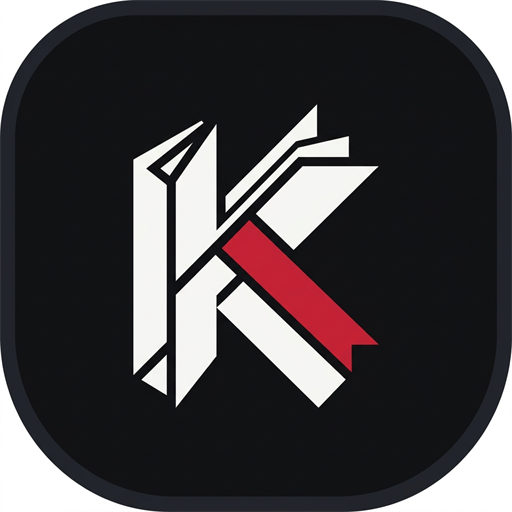

<p align="center">
  
</p>

<h1 align="center">📖 KuroRead</h1>

<p align="center">
  <strong>Aplikasi Baca Light Novel & Web Novel Modern dengan Desain Dark Editorial Solid Contrast.</strong>
</p>

<p align="center">
  
  
  
  
</p>

---

## 🚀 Download APK (Android Release)

Unduh dan instal langsung file APK KuroRead:
- 📥 **[Download KuroRead v1.1.0 APK (Latest)](KuroRead-v1.1.0.apk)** *(Versi terbaru - Tersedia di root & folder `release/`)*
- 📦 **[Download KuroRead v1.0.0 APK](release/KuroRead-v1.0.0.apk)** *(Arsip v1.0.0)*
- 🏷️ Atau cek tab **[Releases](https://github.com/Epithap/KuroRead/releases)** untuk update dan changelog lengkap.

---

## ✨ Fitur Utama

- **🎨 Modern Dark Editorial Aesthetic**:
  - Palet warna solid arang pekat (`#0B0C0E`), slate container (`#14171E`), dan aksen *Kuro Crimson* (`#E53935`).
  - *Zero AI Slop & No Muddy Gradients* — kontras tajam, teks tajam, dan kenyamanan membaca maksimal di malam hari.
- **📚 Katalog & Rekomendasi Mingguan**:
  - Carousel rekomendasi interaktif dengan *horizontal swipe*, auto-sync dots indicator, dan navigasi cepat.
  - Koleksi judul populer: *Lord of the Mysteries*, *Omniscient Reader's Viewpoint*, *Solo Leveling*, *The Beginning After the End*, *Reverend Insanity*, dan banyak lagi.
- **⚡ Pencarian Cepat & Filter Genre**:
  - Filter instan berdasarkan kategori (*Fantasy, Mystery, Cultivation, Dark Fantasy, Sci-Fi*).
  - Pencarian judul dan sinopsis secara real-time.
- **📖 Reader Interaktif & Nyaman**:
  - Dukungan navigasi bab (Next/Prev), pengaturan tipografi, dan bookmark otomatis.
  - Detail modal (*bottom sheet*) untuk melihat sinopsis lengkap dan metadata novel.
- **🔄 Sync & Scraper Terintegrasi**:
  - Dilengkapi script scraper Node.js (`scraper.mjs`, `sync_sakura_all.mjs`) serta bridge native scraper Android (`WebNovelScraper.kt`).

---

## 📂 Struktur Repositori

```
kuroread/
├── 📱 KuroRead-v1.1.0.apk             # APK terbaru (v1.1.0) di root
├── 📱 release/
│   ├── KuroRead-v1.1.0.apk            # File APK v1.1.0
│   └── KuroRead-v1.0.0.apk            # File APK v1.0.0
│
├── 🤖 android_studio_project/         # Project lengkap Android Studio (Gradle + Kotlin)
│   ├── app/
│   │   ├── src/main/java/com/kuroread/app/
│   │   │   ├── MainActivity.kt        # Entry point Android & WebView Bridge
│   │   │   ├── data/WebNovelScraper.kt# Native Scraper Engine
│   │   │   ├── model/Novel.kt         # Model data
│   │   │   └── ui/screens/            # Screen Compose (Home, Reader, Collection, dll)
│   │   ├── src/main/res/              # Ikon Launcher & Aset Resource
│   │   └── src/main/assets/           # Bundle aset web & database offline
│   └── build.gradle.kts
│
├── 🎨 android_compose/                # Blueprint kode native Jetpack Compose murni
│
├── 🌐 Web Prototype / Core Engine:
│   ├── index.html                     # Tampilan interface reader
│   ├── styles.css                     # Gaya CSS Dark Editorial solid contrast
│   ├── script.js                      # Logika reader, carousel, dan filter
│   ├── data/novels_db.json            # Database lokal novel & bab
│   ├── scraper.mjs                    # Scraper novel berbasis JavaScript
│   ├── sync_sakura_all.mjs            # Sinkronisasi data otomatis
│   └── server.js                      # Server backend lokal Node.js
│
└── 🖼️ assets/
    ├── app_icon.png                   # Ikon resmi KuroRead
    ├── covers/                        # Cover art novel
    └── icons/                         # Ikon SVG navigasi & utilitas
```

---

## 🛠️ Cara Menjalankan

### 1. Langsung di Android
- Unduh **`KuroRead-v1.1.0.apk`** ke smartphone Android Anda.
- Buka file APK dan izinkan instalasi dari sumber tidak dikenal jika diminta.
- Buka aplikasi **KuroRead** dan nikmati pengalaman membaca.

### 2. Membuka di Android Studio (Development)
1. Buka folder **`android_studio_project`** menggunakan Android Studio (versi Hedgehog atau lebih baru).
2. Tunggu proses Gradle Sync selesai.
3. Jalankan aplikasi di emulator atau perangkat fisik (Run ▶️).

### 3. Menjalankan Versi Web / Simulator
Cukup buka file `index.html` langsung di browser Anda, atau gunakan server lokal:
```bash
# Jalankan menggunakan Node.js
node server.js
```
Lalu buka `http://localhost:3000` pada browser favorit Anda.

---

## 🛠️ Tech Stack

- **Android Client**: Kotlin, Jetpack Compose, AndroidX WebKit, Jsoup.
- **Frontend / Engine**: HTML5, CSS3 Modern, Vanilla JavaScript (ESNext).
- **Backend & Tooling**: Node.js, Cheerio, Axios.
- **Design System**: Plus Jakarta Sans Typography, Solid Editorial Dark Theme.

---

## 📄 Lisensi & Kredit

- Dibuat dan dikembangkan oleh **[Epithap](https://github.com/Epithap)**.
- Konten novel dan cover art adalah hak cipta dari masing-masing penulis dan penerbit terkait.
